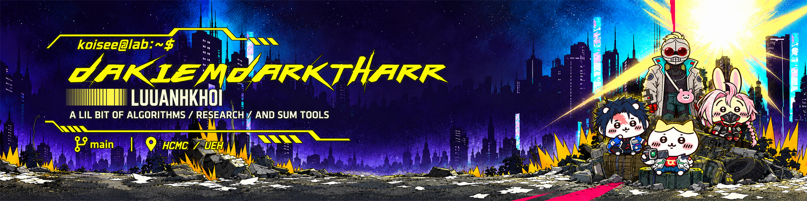
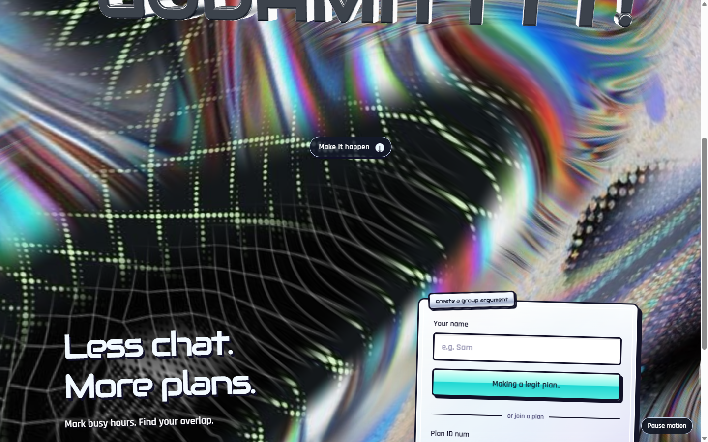

<a href='https://github.com/dakiemdarktharr/dakiemdarktharr/blob/main/assets/profile-intro/ascii-video.mp4'>
  <picture>
    <source media='(prefers-reduced-motion: reduce)' srcset='assets/profile-intro/mission-brief.png' />
    
  </picture>
</a>

[Replay with audio / Xem lại kèm âm thanh](https://github.com/dakiemdarktharr/dakiemdarktharr/blob/main/assets/profile-intro/ascii-video.mp4) · [Full-resolution card / Ảnh thông tin rõ nét](assets/profile-intro/mission-brief-original.png)

# Lưu Anh Khôi · KoiSee

`dakiemdarktharr` · UEH · Ho Chi Minh City, Vietnam · UTC+7

**Problem solving → clear workflows → useful software.**

I study at UEH and build practical apps, desktop tools and research prototypes. I like turning a messy problem into clear constraints, a thoughtful workflow and something people can try.

Mình học tại UEH, thích giải bài toán khó, thiết kế luồng xử lý rõ ràng rồi biến ý tưởng thành sản phẩm dùng được — từ tool nhỏ đến prototype nghiên cứu.

🏆 **NoSleepClub team lead · MLAI Hackathon 2026**

**1st Prize — VNG AI Agent track · 3rd Prize Overall — across all three tracks.** These are two distinct awards received by the team.

I led the team and took responsibility for workflow, frontend and backend. / Mình là Leader, phụ trách workflow, frontend và backend.

**Open to hackathon teammates and research partners in HCMC — gặp offline được thì càng tốt.**

[Email / Gửi email](mailto:daethphate@gmail.com) · [Instagram / Nhắn mình](https://www.instagram.com/koiluuuuv/) · [Public repositories / Repo công khai](https://github.com/dakiemdarktharr?tab=repositories)

## `> whoami --strengths`

- **Problem solving & algorithms / Tư duy bài toán:** break problems into rules, constraints and edge cases; build a habit of testing assumptions.
- **Workflow and product engineering / Thiết kế luồng và sản phẩm:** connect user journeys, frontend, backend, data and human review; led the end-to-end workflow work for NoSleepClub.
- **Useful software / Ứng dụng thực tế:** build local-first learning and desktop tools, web apps and multimedia utilities with clear setup and usage paths.
- **Research prototyping / Thử nghiệm nghiên cứu:** work with baselines, data audits and controlled evaluation; label a prototype as a prototype and report inconclusive results honestly.

**Stack across selected projects:** `C++20` · `Qt` · `OpenCV` · `FFmpeg` · `C# / .NET` · `Python / NumPy` · `TypeScript` · `React / Next.js / Electron` · `SQLite` · `MongoDB`.

Project descriptions reflect public repositories and their documented evidence. Research results below are not presented as proven scientific or production outcomes.

## `> ls team_and_product_builds/`

### [NoSleepClub Support Desk](https://github.com/dakiemdarktharr/nosleepclub-support-desk) · award-winning hackathon project

A conversational support desk that gathers missing context, retrieves source-backed guidance, applies policy checks, routes cases for human review and keeps decision history. I led the team and owned workflow, frontend and backend.

Mình phụ trách workflow, frontend và backend. Đội đạt **giải Nhất track VNG AI Agent** và **giải Ba chung cuộc (Overall) trên cả 3 track**. Demo dùng dữ liệu và quyền mô phỏng, không phải hệ thống chính thức của VNG.

`TypeScript` · `Next.js` · `MongoDB` · `human-in-the-loop`

[Live demo](https://vng-support.vercel.app/) · [Workflow and source](https://github.com/dakiemdarktharr/nosleepclub-support-desk#readme) · [Official results announcement](https://www.facebook.com/hutechuniversity/posts/pfbid02aDmtNL88SKFYwZUSW7gRMWut1BLRCKFEPxb2ZkhA3j2vRQx8P5epe2AaP63dhZ82l)

### [Who’s free, gdmit](https://github.com/dakiemdarktharr/WHOS_FREE_GDMIT) · group scheduling

People mark busy hours; the app ranks shared one-hour windows by the fewest conflicts and handles timezone-aware availability. The live page and create/join entry point are available; the multi-user room flow was not revalidated in this profile review.

Ứng dụng tìm giờ chung ít vướng lịch nhất, có tính đến múi giờ. Ảnh bên dưới là landing page trực tiếp, không phải ảnh một phòng đã được tạo.

`TypeScript` · `Next.js` · `MongoDB` · `Socket.io` · `Three.js`

[Live demo / Mở demo](https://whos-free-gdmit.vercel.app/) · [Setup and details](https://github.com/dakiemdarktharr/WHOS_FREE_GDMIT#readme)

### [TreasureTrove](https://github.com/dakiemdarktharr/treasuretrove) · electronic-components inventory

A personal parts workbench to photograph, search and organize components, track quantities and keep each account’s inventory separate. The deployed app requires an account to view an inventory; recovery uses a recovery key, while email ownership verification and reset email are not configured.

Sổ linh kiện điện tử cá nhân: thêm ảnh, số lượng, tìm theo mã/tên/công dụng và quản lý bộ sưu tập riêng.

`TypeScript` · `Next.js` · `MongoDB` · `Sharp`

[Open app / Mở ứng dụng](https://treasuretrove-tau.vercel.app/) · [Source and setup](https://github.com/dakiemdarktharr/treasuretrove#readme)

## `> ls useful_tools/`

### [ASCII Video 4K](https://github.com/dakiemdarktharr/ascii_video_4k) · desktop and media tooling

A C++20 desktop and Docker utility that converts images and videos into ASCII art. It supports Full HD/4K output, edge enhancement and MP4 audio preservation by default; Windows and Ubuntu installers are published.

Công cụ chuyển ảnh/video thành ASCII, có giao diện desktop, CLI và Docker. Video variable-frame-rate chưa giữ nguyên timestamp; phần cứng tăng tốc chưa được hỗ trợ.

`C++20` · `Qt` · `OpenCV` · `FFmpeg` · `CMake`

[Download / Tải ứng dụng](https://github.com/dakiemdarktharr/ascii_video_4k/releases/latest) · [Validation record](https://github.com/dakiemdarktharr/ascii_video_4k/blob/main/VALIDATION.md) · [Source and guide](https://github.com/dakiemdarktharr/ascii_video_4k#readme)

### [WordNest](https://github.com/dakiemdarktharr/WordNest) · offline-first vocabulary learning

Import vocabulary TXT files, then study with flashcards, quizzes and deterministic spaced-repetition practice. Windows and macOS desktop releases are available alongside a web build. Desktop progress stays on the device; web and desktop data do not sync.

Nhập TXT để học từ vựng bằng flashcard, quiz và lịch ôn cách quãng. Luồng học dùng quy tắc rõ ràng, không dựa vào AI sinh nội dung.

`TypeScript` · `React` · `Electron` · `local-first`

[Try the web app](https://wordnest-eta.vercel.app/) · [Desktop downloads](https://github.com/dakiemdarktharr/WordNest/releases/latest) · [Install guide](https://github.com/dakiemdarktharr/WordNest/blob/HEAD/docs/INSTALL.vi.md)

### [Codeforces Alarm](https://github.com/dakiemdarktharr/code_force_alarm) · Windows productivity tool

A Windows tray app that watches for rated Codeforces Div. 1–4 contests and sends desktop reminders. Gmail reminders are optional and require each user to configure their own Google OAuth client. The computer must be awake and signed in for monitoring.

Ứng dụng chạy ở system tray, có lịch sử và tạm dừng/tiếp tục; có bộ cài Windows trên trang Releases.

`C#` · `.NET Framework` · `Windows` · `OAuth`

[Download / Tải ứng dụng](https://github.com/dakiemdarktharr/code_force_alarm/releases/latest) · [Setup and limitations](https://github.com/dakiemdarktharr/code_force_alarm#readme)

## `> ls design_and_research/`

### [hamanti](https://github.com/dakiemdarktharr/hamanti) · visual-aesthetics handbook

An interactive 300-entry handbook of interface aesthetics, typography and art influences, with search, filters and animated card/hand visuals. The catalog is broader than its current image galleries; only a subset of styles has a populated, reviewed gallery.

Sổ tay tra cứu phong cách giao diện, typography và ảnh hưởng nghệ thuật; nội dung hình ảnh đang được bổ sung dần.

`TypeScript` · `Three.js` · `search` · `interactive design`

[Open the handbook](https://hamanti.vercel.app/) · [Source and content notes](https://github.com/dakiemdarktharr/hamanti#readme)

### [CAISSA-JEPA](https://github.com/dakiemdarktharr/caissa-jepa) · research in progress

An experimental program on action-conditioned latent prediction and planning in deterministic two-player games, with data audits, baselines and controlled comparisons. The current public report says its V2.8 study found no observed advantage over task-value-dynamics; the V2.9 development match is still pending, so no JEPA strength result is established.

Thử nghiệm học biểu diễn và lập kế hoạch có đối chứng. Kết quả hiện tại chưa chứng minh JEPA vượt baseline.

`Python` · `NumPy` · `game AI` · `reproducible evaluation`

[Current research status](https://github.com/dakiemdarktharr/caissa-jepa#tested-model-settings-and-development-results) · [Ground truth log](https://github.com/dakiemdarktharr/caissa-jepa/blob/main/GROUND_TRUTH.md)

Historical V2.5 development figure; the paragraph above links to the newer V2.8/V2.9 status. / Biểu đồ V2.5 cũ; trạng thái mới hơn được ghi ở README hiện tại.

### [Fly Piano Lab](https://github.com/dakiemdarktharr/eureka-fly-piano) · simulation research

A research simulation for inspecting a 412-neuron fly motor circuit and its control of a simulated body. The V5 diagnostic matched 17 of 100 requested note events (precision 31.48%, recall 17%, F1 22.08%). This is model behavior in simulation, not biological piano learning or a whole-brain digital twin.

Mô phỏng mạch vận động ruồi để thử nghiệm điều khiển và xem hoạt động neuron; kết quả hiện tại chưa đạt mục tiêu đặt ra.

`Python` · `MuJoCo` · `optimization` · `3D visualization`

[V5 scope and results / Phạm vi và kết quả](https://github.com/dakiemdarktharr/eureka-fly-piano/blob/main/project/v5/README_vi.md) · [Research notes](https://github.com/dakiemdarktharr/eureka-fly-piano/blob/main/research/learning_review_vi.md)

Model signals and simulation geometry, not biological recordings. / Tín hiệu mô hình và hình học mô phỏng, không phải dữ liệu sinh học.

### [Palm Studio / Palmistry](https://github.com/dakiemdarktharr/palmistry) · computer-vision prototype

A local tool for annotating three major palm lines and width landmarks, plus a Python pipeline for data checks and segmentation experiments. Public evaluation uses synthetic fixtures only; the one-epoch fixture model’s mean IoU was 0.050990. Accuracy on real hands has not been established.

Công cụ dán nhãn và thử nghiệm phân đoạn đường lòng bàn tay. Kết quả synthetic chỉ kiểm tra pipeline, không chứng minh độ chính xác trên ảnh người thật hay dự đoán tính cách/số mệnh.

`Python` · `NumPy` · `React` · `computer vision`

[Keypoint workflow](https://github.com/dakiemdarktharr/palmistry/blob/main/docs/KEYPOINT_PIPELINE.md) · [Verification and limitations](https://github.com/dakiemdarktharr/palmistry/blob/main/docs/verification.md)

## `> team_up --location hcm`

I bring problem solving, workflow design and hands-on product building. I’m looking for hackathon teammates, research partners and people who want to test useful tools.

Mình tìm bạn ở **TP.HCM có thể gặp offline** để thi hackathon, nghiên cứu khoa học hoặc build tool hữu ích. Nhắn mình ý tưởng/cuộc thi, phần bạn muốn làm và thời gian có thể gặp.

[daethphate@gmail.com](mailto:daethphate@gmail.com) · [@koiluuuuv](https://www.instagram.com/koiluuuuv/)

Chess / Cờ vua · League of Legends / Liên Minh Huyền Thoại · Matcha · Chiikawa

*One more idea. One more game. Maybe both.*

Selected public projects reviewed on 2026-10-24. The image for Who’s free, gdmit is a live landing-page capture; the room flow was not revalidated. Public screenshots are included where available. Fan-art characters and demo media belong to their respective creators; no affiliation.
