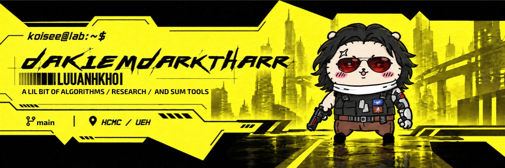
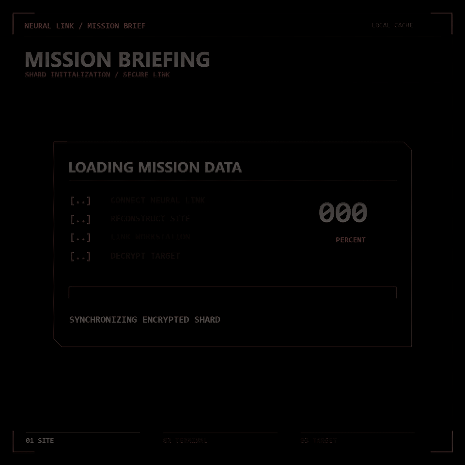
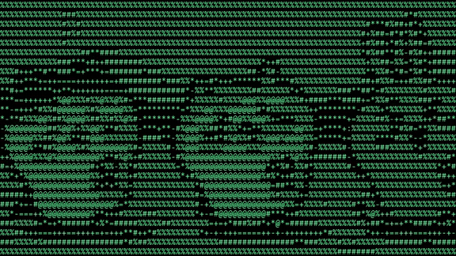

<a href="https://github.com/dakiemdarktharr/dakiemdarktharr/blob/main/assets/profile-intro/ascii-video.mp4">
  <picture>
    <source media="(prefers-reduced-motion: reduce)" srcset="assets/profile-intro/mission-brief.png" />
    
  </picture>
</a>

[Replay with audio / Xem lại kèm âm thanh](https://github.com/dakiemdarktharr/dakiemdarktharr/blob/main/assets/profile-intro/ascii-video.mp4) · [Full-resolution card / Ảnh thông tin rõ nét](assets/profile-intro/mission-brief-original.png)

# Lưu Anh Khôi · KoiSee

`dakiemdarktharr` · UEH · Ho Chi Minh City, Vietnam · UTC+7

**Problem solving → clear workflows → working software.**

Mình học tại UEH, thích giải bài toán khó, thiết kế luồng xử lý và biến ý tưởng thành ứng dụng dùng được. Build tool cho nhu cầu hằng ngày, prototype nghiên cứu, và vài project chỉ vì thấy vui.

I'm a UEH student in HCMC who enjoys problem solving, workflow design, useful software and research experiments. Sometimes a small idea refuses to stay small.

🏆 **Team lead, NoSleepClub — First Prize, VNG AI Agent track · MLAI Hackathon 2026.**

**Looking for hackathon teammates & research partners in HCMC — gặp offline được thì càng tốt.**

[Email / Gửi email](mailto:daethphate@gmail.com) · [Instagram / Nhắn mình](https://www.instagram.com/koiluuuuv/) · [Public repos / Repo công khai](https://github.com/dakiemdarktharr?tab=repositories)

## `> whoami --practical`

- **Problem solving & algorithms / Tư duy bài toán:** breaking a problem into constraints, rules and edge cases · chia nhỏ bài toán, làm rõ điều kiện và các trường hợp biên.
- **Workflow & full-stack / Từ luồng đến sản phẩm:** connecting user journeys, frontend, APIs and persistence; leading the workflow/frontend/backend work for NoSleepClub · nối các phần thành một luồng dùng được.
- **Research engineering · still learning / Đang đào sâu:** model prototypes, data pipelines, baselines and reproducible evaluation · viết công cụ thử nghiệm, kiểm tra dữ liệu và phân biệt kết quả với giả thuyết.

**Stack across these projects:** `C++ / Qt / OpenCV / FFmpeg` · `C# / .NET` · `Python / NumPy` · `TypeScript / React / Next.js / Electron` · `MongoDB`.

AI-assisted development. Project docs distinguish implemented behavior, validation evidence and open questions.

## `> ls selected_builds/`

### [NoSleepClub Support Desk](https://github.com/dakiemdarktharr/nosleepclub-support-desk) · hackathon team project

I led the team and took responsibility for **workflow, frontend and backend**. The app connects conversational intake, source-backed retrieval, server-side policy checks, human review and audit history.

Mình làm **Leader, phụ trách workflow, frontend và backend**. Đội đạt **giải Nhất bảng AI Agent do VNG chủ trì**. Bản trình diễn dùng quyền và thao tác hạ tầng mô phỏng của dự án.

`TypeScript` · `Next.js` · `MongoDB` · `RAG` · `human-in-the-loop`

[Live demo](https://vng-support.vercel.app/) · [Source & workflow](https://github.com/dakiemdarktharr/nosleepclub-support-desk#readme) · [Results announcement / Công bố kết quả](https://www.facebook.com/hutechuniversity/posts/pfbid02aDmtNL88SKFYwZUSW7gRMWut1BLRCKFEPxb2ZkhA3j2vRQx8P5epe2AaP63dhZ82l)

### [ASCII Video 4K](https://github.com/dakiemdarktharr/ascii_video_4k) · desktop & media tooling

A native image/video-to-ASCII app with Full HD/4K presets, audio preservation, a bounded multithreaded frame pipeline, CLI and Docker support. Windows and Ubuntu installers are published.

Chuyển ảnh/video thành ASCII, giữ âm thanh, xử lý theo pipeline có giới hạn hàng đợi và xuất media cho GitHub. Bản gốc được giữ riêng tại [ascii-video-cpp](https://github.com/dakiemdarktharr/ascii-video-cpp).

`C++20` · `Qt` · `OpenCV` · `FFmpeg` · `CMake`

[Download / Tải ứng dụng](https://github.com/dakiemdarktharr/ascii_video_4k/releases/latest) · [Source & guide](https://github.com/dakiemdarktharr/ascii_video_4k#readme) · [Validation record](https://github.com/dakiemdarktharr/ascii_video_4k/blob/main/VALIDATION.md)

Conversion showcase from the original app; not a benchmark of the new 4K defaults. / Demo bản gốc, không phải phép đo chất lượng bản 4K. [Full video](https://github.com/dakiemdarktharr/dakiemdarktharr/blob/main/assets/ascii-video/ascii-video.mp4).

### [WordNest](https://github.com/dakiemdarktharr/WordNest) · offline-first learning

Turn vocabulary TXT files into flashcards, quizzes and deterministic spaced-repetition practice. Practice retries wrong answers while keeping first-attempt scores separate. Windows/macOS desktop apps and a web version.

Nhập TXT, học từ vựng, luyện đến khi đúng và lưu tiến độ tại máy. Không cần tài khoản hay AI sinh nội dung cho luồng học desktop.

`TypeScript` · `React` · `Electron` · `local-first`

[Try on web / Dùng thử](https://wordnest-eta.vercel.app/) · [Download / Tải desktop](https://github.com/dakiemdarktharr/WordNest/releases/latest) · [Source & guide](https://github.com/dakiemdarktharr/WordNest#readme)

### [TreasureTrove](https://github.com/dakiemdarktharr/treasuretrove) · a workbench for electronic components

Search, photograph and organize parts, track quantities, and keep each account's inventory separate. Includes authentication, owner-scoped data access, image processing and stock-update workflows.

Sổ linh kiện cá nhân: tìm theo mã/công dụng, thêm ảnh, tăng giảm số lượng và quản lý bộ sưu tập riêng cho từng tài khoản.

`TypeScript` · `Next.js` · `MongoDB` · `Sharp`

[Open app / Mở ứng dụng](https://treasuretrove-tau.vercel.app/) (cần tài khoản / account required) · [Source & setup](https://github.com/dakiemdarktharr/treasuretrove#readme)

## `> ls research_and_learning/`

- **[CAISSA-JEPA](https://github.com/dakiemdarktharr/caissa-jepa)** — Action-conditioned representation-learning and planning experiments in two-player games, with rule checks, data audits and baseline comparisons. / Thử nghiệm học biểu diễn và lập kế hoạch; **JEPA's advantage remains unproven / chưa chứng minh JEPA tốt hơn baseline**. [Current research status](https://github.com/dakiemdarktharr/caissa-jepa/blob/main/GROUND_TRUTH.md).
- **[Fly Piano Lab](https://github.com/dakiemdarktharr/eureka-fly-piano)** — Motor-readout optimization and 3D neuron-activity inspection in a fly-circuit simulation. / Thử nghiệm tối ưu điều khiển và trực quan hóa mô phỏng; không phải bằng chứng ruồi sinh học học piano. [V5 scope & results](https://github.com/dakiemdarktharr/eureka-fly-piano/blob/main/project/v5/README_vi.md).
- **[Palm Studio / Palmistry](https://github.com/dakiemdarktharr/palmistry)** — Local palm-line annotation, keypoint/CV pipelines, masked-label training and data-integrity checks. / Công cụ dán nhãn, pipeline thị giác máy tính và thử nghiệm mô hình; **real-world accuracy is not established / chưa xác nhận độ chính xác trên dữ liệu thật**. [Current keypoint workflow](https://github.com/dakiemdarktharr/palmistry/blob/main/docs/KEYPOINT_PIPELINE.md).
- **[And I Wonder](https://github.com/dakiemdarktharr/And_I_Wonder)** — A bilingual mathematics/quant self-study studio with lessons, progress tracking and interactive numerical labs. / Biến việc tự học thành ứng dụng có thể khám phá; đây là project học tập, không phải chứng nhận năng lực nghiên cứu hay giao dịch. [Explore / Khám phá](https://and-i-wonder-quant.vercel.app/).

## `> ls small_tools_and_side_quests/`

- **[Who's free, gdmit](https://github.com/dakiemdarktharr/WHOS_FREE_GDMIT)** — Group scheduling with timezone-aware conflict ranking and a Three.js visual interface. / Bớt hỏi “khi nào mọi người rảnh?” trong group chat. [Live demo](https://whos-free-gdmit.vercel.app/).
- **[Codeforces Alarm](https://github.com/dakiemdarktharr/code_force_alarm)** — A C#/.NET Windows tray app for rated-contest reminders, desktop alerts and optional Gmail OAuth. / Nhắc contest, giữ trạng thái qua restart và xử lý lần gửi chưa rõ kết quả. [Download](https://github.com/dakiemdarktharr/code_force_alarm/releases/latest).
- **[No vibe, only brute force](https://github.com/dakiemdarktharr/code_force-no-vibe-only-brute-force-)** — My C++ algorithm-practice log. / Góc luyện thuật toán: bài nhỏ, nghĩ không nhỏ.

## `> team_up --location hcm`

Looking for **hackathon teammates, research partners and people who want to try the tools**. I can help frame the problem, design the workflow and connect frontend/backend pieces. For research, I'd love to work on a concrete question, a baseline and an experiment we can actually inspect.

Mình tìm bạn ở **TP.HCM có thể gặp offline** để thi hackathon, nghiên cứu khoa học hoặc build tool hữu ích. Nhắn mình ý tưởng/cuộc thi, phần bạn muốn làm và lịch có thể gặp — cùng chia việc rồi làm đến nơi đến chốn.

[daethphate@gmail.com](mailto:daethphate@gmail.com) · [@koiluuuuv](https://www.instagram.com/koiluuuuv/)

Chess / Cờ vua · League of Legends / Liên Minh Huyền Thoại · Matcha · Chiikawa

*One more idea. One more game. Maybe both.*

Selected public work reviewed on 2026-10-18. Research prototypes, learning projects and downloadable tools have different evidence limits. Fan-art characters and underlying demo animation belong to their respective creators; no affiliation.
